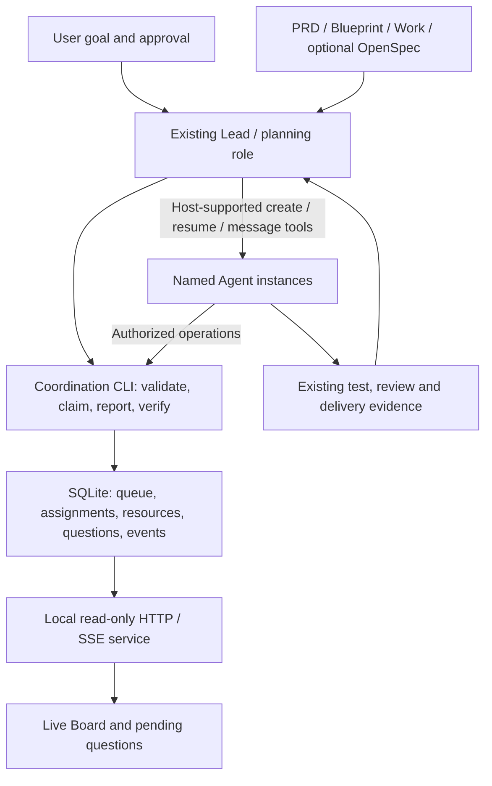

# Lightweight task coordination tool: system design draft

Status: the historical verification boundaries below describe the original P0–P4 implementation and checks. The Board execution identity/workspace schema-4 extension is implemented and integrated; automated verification and subsequent repair evidence are tracked in the local stage packet (`docs/verification/active/board-execution.md`). Its canonical contract is in [the task-coordination Skill reference](../skills/team-core/references/task-coordination.md#executor-identity-lead-inline-work-and-registered-workspaces). P5 real-project trial, user acceptance, and macOS/Linux verification remain incomplete. Source, generated artifact, real installation, and current-session loading are assessed separately. No local Kit installation, commit, push, or release is authorized.

Companion document: [implementation plan](task-coordination-plan.md). This design applies to actual executors with the required permissions; role responsibilities do not establish a separate process identity. The main Lead may perform implementation, Skill reading, coverage/packet work and self-checks serially. Self-checks do not satisfy independent gates; actual identity remains unknown when the host does not expose it.

## Approved executor/workspace extension

The current canonical contract is the linked Skill reference; this short trace records how the approved extension supersedes the original single-checkout/schema-3 limits above without erasing the original design history. It covers schema 4, four executor modes, principal-aware independent checks, and registered same-repository Git workspaces. It remains an optional Board capability; Board pass-through never creates a child.

| Prior boundary | Approved current rule |
| --- | --- |
| One checkout per Board; multi-worktree deferred | Register the main checkout and up to 99 additional linked worktrees from the same Git common directory. Reject separate clones, even with matching remotes/names. Revalidate registry/source/grant/replay bindings. |
| Schema 3 | Schema 4 is explicit. Migrate 3→4 only through the named migration; preserve the historical 2→3 route. Never auto-migrate. Restore-new-target preserves the source schema. Preserve declared eligible roles and named logical resources; rebuild old path keys against `main` physical paths so conflicts remain effective. Invalidate pre-4 executor/evidence authority and revoke old grants. |
| Role and worker identity implicitly paired | Responsibilities are separate from actual executor. Modes are `direct`, `lead-proxy`, `lead-inline`, and `lead-recorded`; Lead-inline uses the actual Board `leadId`, and Lead-recorded attributes a real worker's evidence without granting the worker Board DB-write authority. Unknown native host identity remains unknown. |
| Self-check could be confused with independent result | Required checks have IDs/kinds (`independent-review`, `independent-evaluation`, `independent-test`) and frozen-submission subjects. Acceptance uses only a current closed result with a known distinct principal and correct registered role; aliases/self/unknown/Lead-inline do not satisfy independence. Durable check bindings are not dependency edges; reopening a required checker withdraws producer acceptance/downstream consumption while preserving closed checker history, then requires a current check before reacceptance. |
| One relative-path namespace | Work scopes are string-compatible or typed `{workspaceId,path}`; task default workspace is `main`. Source refs can bind workspace IDs. Different worktrees can own distinct physical files; aliases conflict; logical named resources conflict across all workspaces. Direct worker CWD is trusted process context and must be inside the bound workspace, not caller-provided JSON. |

See [the canonical Task Board contract](../skills/team-core/references/task-coordination.md#executor-identity-lead-inline-work-and-registered-workspaces) for field names, operations, permission limits and revalidation rules. This document does not claim that implementation, generated runtime, host identity observation or user acceptance has passed; those states require current source and stage evidence.

## 1. Goals and initial scope

The goal is to reduce situations where one Agent carries all remaining work while the Lead waits passively for a long time, while avoiding excessive decomposition of small tasks, duplicate execution and competing task states.

The initial version provides structured execution work packages, dependency queries, controlled claims, progress and blocker reports, questions about the current task, safe handoffs, result verification and a live human-readable Board for one local project. The existing Lead/planning Agent decomposes tasks; the tool validates and stores the structure without additional model calls.

Runtime boundary: one host, a supported local filesystem, one explicit coordination root, one current Lead and a small number of concurrent instances. Schema 4 registers the main checkout and explicitly verified linked worktrees from the same repository; separate clones, cross-machine operation and network-drive sharing remain unsupported. Workspace bindings, physical path aliases and logical resources shared across workspaces follow the canonical task-coordination contract.

Excluded: distributed scheduling, competing Leads, background Agent daemons, automatic budget increases, automatic business-operation retries, timeout-based preemption, automatic process termination, automatic code commits and a full project-management platform. The live Board allows an on-demand local HTTP/SSE service; it does not run models, start Agents or advance tasks because a browser is open. The tool does not take over existing PRD, Blueprint, OpenSpec or test-acceptance responsibilities.

Small, clear tasks retain the existing light path. Use a queue only when multiple independent work packages, handoffs or continued allocation provide real value; queue initialization is not a prerequisite for every task.

## 2. Verified foundations and design choices

Observed repository foundations:

- Existing tools use PowerShell 7/Git; `team-core/scripts/documentation.ps1` provides patterns for exclusive file locks, temporary-file replacement and interruption records.
- `scripts/deploy-user.ps1` has version, snapshot and recovery constraints. These implementations are references, not a shared transaction library to extract without verification.
- [Role routing](../skills/team-core/references/role-routing.md) assigns instance, capacity and work-allocation management to the Lead; [file ownership](../skills/team-core/references/file-ownership.md) requires a single write owner and safe transfer.
- The [OpenSpec lifecycle](../skills/team-core/references/spec-lifecycle.md) keeps implementation tasks and progress in `tasks.md`; [handoff rules](../skills/team-core/references/agent-handoffs.md) require continuity of the same outcome and history.
- This planning pass did not find `openspec/team-integration.json` in this repository and does not initialize OpenSpec as a result. Implementation must rediscover the target project's integration state.

The user confirmed the separation of source code, Skill contracts and installation artifacts, and requested a database, live Board and questions scoped to the current task. The table preserves the design choices and their rationale; P0 has fixed the concrete runtime, while permission adaptation and maintenance are verified in later stages. Confidence percentages are subjective engineering judgments, not measured probabilities.

| Choice | Judgment and rationale |
| --- | --- |
| Build a thin task-coordination CLI using mechanisms from existing projects | Confidence: 90%. Fits the existing permission and acceptance system and avoids three competing progress records; concurrency and fault experiments are still needed. |
| Use a transactional SQLite database as the sole runtime state, with a cross-platform core runtime | Confidence: 95%. Reuses transactions, constraints, backup and recovery instead of custom file transactions; the actual driver and distribution still need verification on each platform. |
| Make the initial Board a local, read-only live Web page using SSE updates | Confidence: 94%. Server-pushed state suits one-way presentation; disconnects, replay and slow clients need handling. |
| Keep instance startup and resumption with the Lead | Confidence: 97%. Preserves existing role and capacity boundaries; task state alone cannot wake a host child Agent. |
| Allow child Agents to claim work packages within a scope authorized in advance by the Lead | Confidence: 89%. Reduces item-by-item relaying, but requires joint validation of dependencies, roles, reserved resources and authorization revisions. |
| Persist and deduplicate current-task questions, issue bounded notifications and let the Lead handle blockers by priority | Confidence: 94%. Preserves clarification while limiting message fan-out and unrelated context; concrete batch sizes need verification under concurrency. |

The core candidate is supported Node.js LTS plus a SQLite driver adapter, unifying the CLI, database and live service. PowerShell may retain a compatibility entrypoint but does not own core state or platform branches. Freeze the driver in P0: first check whether built-in `node:sqlite` meets the selected LTS API, stability and SQLite patch requirements; otherwise review mature drivers and the cost of distributing prebuilt binaries, without silently adding native compilation dependencies. JSON is only an input/output or export format, not runtime state or a recovery journal.

P0 observed and selected official Node 26.13.0 LTS with built-in SQLite 3.54.0 as the development baseline. It uses standard-library `node:sqlite`, with no third-party driver or native compilation introduced at present. The entrypoint is provisionally restricted to the verified 26.x API family and checks the minimum runtime version and SQLite fix requirements. The isolated Windows runtime probe passed; other-platform checks and complete behavioral verification remain pending, so this does not establish full support.

The runtime and driver versions are new dependencies: display them explicitly and obtain the required dependency-installation authorization before installation. Official Windows/macOS/Linux support needs corresponding evidence; SQLite's cross-platform availability does not establish cross-platform verification of the complete tool.

The added runtime is a dependency only of the Task Board capability; existing Team/light-path work without the Board does not require Node or SQLite installation. Missing dependencies explicitly prevent Board startup while existing allocation methods remain available. If a Board with an existing database is unavailable, first hand off in-flight facts; do not silently create another queue or pretend no unfinished work exists.

## 3. System boundaries and modules



| Module | Responsibilities | Excluded responsibilities |
| --- | --- | --- |
| Command entrypoint | Arguments, JSON input/output, stable error codes | Executing commands or scripts embedded in tasks |
| Storage | SQLite transactions, constraints, migrations, backups, idempotent operations | Model judgments or Agent liveness judgments |
| Task graph | Dependency validation, cycle detection, readiness reasons | Inventing user requirements from code |
| Assignment and resources | Authorized scope, claim credentials, file/resource conflicts | OS permission isolation or forcibly preventing arbitrary code from writing files |
| Results and handoffs | Submission evidence, reopening, history preservation, transfer records | Deciding on its own that the user has accepted results |
| Question inbox | Current-task validation, deduplication, pending questions and answer revisions | Broadcasting project-wide questions or resolving conflicting user intent |
| Live service | Committed events, reconnect recovery, bounded push | Model calls, Agent startup/termination, an additional task database |
| Data maintenance | Retention policy, archival, cleanup previews, backup and compression | Automatically deleting active tasks or bypassing maintenance authorization |
| Skill integration contract | Lead scheduling and when each role operates | Adding a permanent scheduling Agent |

This section also serves as the feature's module map; do not create a competing Blueprint. Current implementation responsibilities and dependency directions:

| Module ID | Files | Owner/stage | Allowed dependencies |
| --- | --- | --- | --- |
| TC-STORE | `packages/task-board/src/storage/` | Database Specialist, P0–P4 | SQLite driver, schema, transactions, migrations, backups and physical maintenance |
| TC-DOMAIN | `packages/task-board/src/domain/` | Same core owner, P1 | Pure graph, state and shared contracts; no host calls or rendering |
| TC-COORD | `packages/task-board/src/coordination/` and `src/questions/` | Backend owner, P2 | DOMAIN, STORE; instance authorization, resources, assignments, questions |
| TC-SOURCE | `packages/task-board/src/sources/` | Core backend owner, P2 | Bounded reads of existing Work/OpenSpec; no source changes or new task authority |
| TC-CLI | `packages/task-board/src/cli/` | Backend integration owner, P1–P2 | DOMAIN, STORE, COORD; command assembly only |
| TC-SERVICE | `packages/task-board/src/server/` | Backend owner, P3 | Consistent snapshots, committed events, SSE; no Agent scheduling |
| TC-VIEW | `packages/task-board/web/` | Page owner, P3 | Read-only API and events; no direct DB reads or writes |
| TC-MAINTAIN | `packages/task-board/src/maintenance/`, `src/cli/maintenance.mjs` and `src/cli/data-lifecycle.mjs` | Backend owner, P1/P4 | Retention decisions and CLI assembly call STORE; SQL, physical maintenance and recovery remain with the database owner; no unauthorized record deletion |
| TC-POLICY | `skills/team-core/references/task-coordination.md` and thin Skill references | Documentation owner, P2 | Approved protocols and existing role/acceptance contracts |
| TC-VERIFY | `tests/task-board/` and `tests/test-task-board-package.ps1` | Independent Tester, P0–P4 | Public CLI, isolated fixtures and necessary controlled fault entrypoints |

Paths are relative to the repository root. `packages/task-board/` is the sole editable implementation source; the Skill stores the contract and invocation guidance, and `skills/team-core/runtime/task-board/` stores generated installation artifacts. Build caches stay out of installation units, and generated artifacts must not be maintained manually. Split code into complete, bounded modules rather than creating a file for every function.

## 4. Information ownership: one source, multiple execution work packages

| Content | Retained authoritative source | Queue contents |
| --- | --- | --- |
| Requirements and user decisions | Currently applicable PRD/approved decisions/OpenSpec specs | Source references, applicable revisions, summaries of required constraints |
| Module and file responsibilities | Blueprint/project structure contract | Allowed file scope and associated modules for each work package |
| Implementation tasks | Existing Work; OpenSpec `tasks.md` when enabled | Mapping from original task IDs to execution work-package IDs |
| Concrete instance allocation and execution phase | This queue | Current instance, claim revision, progress and blockers |
| Tests and manual acceptance | Existing stage packet/verification record | Evidence references and outstanding gates |

One implementation task may map to multiple execution work packages. Closure of all required packages is one input to the Lead's completion judgment; it does not directly check off an OpenSpec task. An existing task checkmark does not automatically close queue work packages either.

The initial version has no unsupervised bidirectional synchronization. After changing relevant sources, the Lead explicitly runs Reconcile: verify source IDs/revisions, preserve existing IDs and history, and invalidate affected evidence and assignments. OpenSpec retains its existing snapshot semantics: ordinary task checkmarks do not change the task contract or invalidate every assignment. If a source becomes inaccessible, a task is deleted or requirements become ambiguous, block dependency decisions; do not silently refresh fingerprints or regenerate tasks that replace the original intent.

A fresh clone must not infer that there is no pending work or that tasks are complete from the absence of a local queue. Rediscover versioned sources and state which context is restored and which execution evidence is unavailable. Portable handoffs continue to follow existing handoff rules.

This requires a bounded amendment to the existing prohibition on a new registry or second task list, approved with the design and written explicitly during implementation: allow a local store of execution-coordination facts, but prohibit duplicating requirements, native implementation progress and acceptance results. Assignments, claim credentials and resource reservations are new coordination facts that cannot be reconstructed losslessly from OpenSpec or Work; only the Board view is a rebuildable projection. After queue loss, stop new claims and reconcile all in-flight writes before deciding how to recover; do not simply rebuild from an upstream list and resume claims.

The existing default of one production writer remains the default for small work. The proposed explicit exception allows the same Lead to assign genuinely independent packages to multiple instances of the same or different roles, provided inputs are ready, files and resources do not overlap, integration ownership is clear and host capacity permits. Each shared interface and concrete write path still has one owner. This exception neither forces parallelism on every task nor authorizes refactoring existing code.

## 5. Data model

The original implementation uses persistent schema 3. The currently approved execution identity/workspace extension uses schema 4; schema 3→4 requires explicit migration, with no automatic migration. Historical schema 2→3 retains its separate existing route, and restore-new-target preserves the source schema. CLI/snapshot protocol versions must not be confused with the database schema. The table describes data responsibilities; exact request fields come from per-command help in the current generated package. Do not submit conceptual fields directly to the CLI.

### Queue and relational tables

`boards` stores schema/board/generation/revision/project/coordinator information and timestamps. Relational and record tables are `tasks`, `task_dependencies`, `workers`, `grants`, `assignments`, `task_resources`, `reservations`, `submissions`, `operation_receipts`, `questions`, `answers`, `audit_events` and `change_events`. Maintenance sessions and pending physical operations live in board metadata; archive markers live in task records; operation audits and receipts reuse the shared tables. There are no separate `maintenance_runs` or `archive_manifests` tables. Relationships have actual records rather than replacing transactions with one whole-board JSON array.

- `boardId` identifies the queue; `generation` changes after explicit recovery/migration to invalidate old credentials.
- `revision` identifies a consistent snapshot; each task also has `taskRevision`, so unrelated task changes do not make every update fail.
- Project binding uses an explicitly normalized coordination root. Paths remain in local runtime state; exports and public documentation contain no personal absolute paths.
- The new flow separates Boards by main session; child Agents inherit their main session. Schema 4 separates executor identity, execution responsibilities and runtime observations; fields, independent-evidence validation and compatibility routes follow the canonical Skill contract. Historical schema 3 requires explicit migration; unknown host identity is not backfilled.

`session-path` derives `_work/task-board/sessions/v1/<digest>` from stable host/main-session identity, and derives `sessionKey` separately from an identity that includes the project ID. Names do not enter paths or identity digests. A changed project assignment conflicts with the original binding rather than silently taking over an old Board through matching names or automatic renaming. New bindings initialize with a canonical relative directory and matching `--session-key`; database opening, receipts and recovery publication all verify the current context. Child Agents must not substitute their own child-thread IDs. The service caches and checks the same key. This prevents cooperating callers from selecting the wrong Board; it does not isolate processes under the same OS user or make old tools enforce new guards automatically.

The display name is the project name plus the session name. Read current host metadata at task start, resumption, explicit reopening and handoff; the Lead runs `session-sync` when a change is found. There is no background polling or native instant-rename subscription. Changes use CAS with a separate `labelRevision`, auditing and events to update the page heading and browser tab, without changing paths, Board identity, task revisions, authorization or acceptance evidence. A request with the same normalized names is an authenticated no-op observation: it creates no revision/event and consumes no operation ID. Replaying an old change receipt does not rewrite a historical name. Without reliable identity, stop the affected new-Board flow; if names are temporarily unreadable, retain known names and mark synchronization pending.

### Work packages

| Field | Meaning |
| --- | --- |
| `id / sourceRefs` | Stable identity and original task/requirement sources; native task hierarchy stays in Work/OpenSpec, and the initial version has no `parentId` request field |
| `title / outcome / acceptanceRefs` | Bounded deliverable, completion conditions and authoritative references |
| `eligibleRoles` and `grants` | Allowed roles and separate authorization records; approved instance sets are managed through Grant, not an `authorizedWorkers` field on Add |
| `dependencies` | Predecessor work-package IDs and explicit required gates |
| `scope.read / scope.write / resources` | Readable/writable relative paths and shared/exclusive resources |
| `priority / approvalRevision / taskRevision` | Scheduling priority, authorization revision and concurrent-update revision |
| `state / phase / progress / blocker` | Lifecycle and actual work phase; merely reporting that work is running is insufficient |
| `assignment / evidenceRefs / history` | Current assignment, result evidence and necessary state-change history |

`phase` is progress information, such as designing tests, migrating source, type-checking, running tests, analyzing failures or waiting for dependencies. It does not create new claim authority.

The initial page shows synchronization time. When no verifiable per-task update time is available, it explicitly shows that the time is unknown; page-receipt time must not stand in for the worker's latest progress, imply loss of contact or trigger automatic release.

`assignment` contains a unique assignment ID, actual host task identity, explicitly selected role, authorization revision and claim-credential digest. Model/reasoning effort records only observable values; unknown values are not inferred from source configuration.

Composite relationship identities require unambiguous encoding or actual composite keys; do not concatenate task/instance IDs with unescaped delimiters. After fetching an authorization record, also verify that its taskId and workerId match the current request; finding a key does not establish authorization. Relationship-key format is part of the persistent data protocol. Format changes require a schema gate and explicit migration, rather than silently reinterpreting old keys.

Each registered workspace has its own local workRoot binding; additional workspaces must be linked worktrees in the same Git common directory, verified through worktree list. Physical files in different worktrees can be allocated independently, path aliases still conflict, and named logical resources conflict globally across workspaces. Scopes, source refs, grants, replay and evidence bind to registered snapshots and are revalidated; workspace identity cannot be inferred from relative paths or repository names.

Do not store secrets, complete raw conversations or large logs. Context primarily consists of short summaries, relevant sources and evidence links; the queue is not a long-term knowledge base.

`questions` links the board, current task, valid assignment, source revision, blocked step, specific question, materials already checked, options and recommendation, impact and deduplication fingerprint. Answers bind to the same identities and revisions rather than relying on a free-text approval such as “yes.” By default, one current assignment has at most one pending question thread, which may contain closely related subquestions about the same step; unrelated questions must not be bundled. Question state is separate from task state; a task may be blocked while awaiting an answer needed to proceed.

## 6. Lifecycle and completion semantics

Initial persistent states are `planned`, `open`, `running`, `blocked`, `submitted`, `closed` and `canceled`. `ready` is computed by queries, not written manually.

| Transition | Actor and conditions |
| --- | --- |
| planned → open | Lead approves after reviewing scope, sources, dependencies and completion conditions |
| open → running | Lead assigns or an authorized worker claims atomically; all eligibility checks pass |
| running → blocked | Current owner reports a concrete blocker; assignment and resource ownership remain |
| blocked → running | Blocker is explicitly resolved and the original assignment remains valid; scope changes require Lead reassessment first |
| running → submitted | Owner submits evidence for the current revision and declares whether writes/processes have ended |
| submitted → closed | Lead checks the tests/review/user gates due for this package and accepts the result |
| submitted → running | Lead returns work to the same owner, preserving issues and repair history; resources are reconfirmed before writing resumes |
| Any unclosed state → canceled | Lead cancels under user or existing authorization, preserves history and handles safe cleanup |
| closed → open | Lead explicitly reopens and marks old evidence applicability; history and repair budgets are not erased |

blocked/running → open requires the Lead's safe Release: confirm writes have ended, invalidate the old assignment, handle unanswered questions and dependencies, release resources that can safely be released, and record the reclaimable state in the same transaction. An ordinary worker must not clear the owner and return work to the queue on its own.

`submitted` does not mean passed; `closed` means only that the bounded package is complete, not that the project, release or manual acceptance is complete. A read-only Reviewer may close a completed review package while its findings remain input to related repair work. Dependencies must reference the actual required gate; merely starting work cannot unlock acceptance.

The initial version allows only two dependency gates: `accepted-result` requires closed work and still-valid required evidence; `frozen-submission` is only for testing/reviewing frozen implementation, requiring submitted work, explicitly stopped writes, and bound source/test/configuration revisions and evidence identifiers. Do not create a cycle by requiring the writer to pass Review before closure while Review waits for writer closure. Returning implementation or changing relevant inputs invalidates the corresponding freeze and downstream verification. Preserve work that remains valid, but pause packages depending on affected evidence. Freeze and resource release are explicit conditions, not inferred from the submitted state name.

Each dependency stores the upstream freeze/accepted-result revision it consumes. Upstream reopening, cancellation or changes to sources or relevant inputs invalidate the corresponding results within a transaction and trace affected transitive dependencies. Closed downstream work retains its historical completion record, but its result may become invalid and cannot unlock new tasks. Running downstream work is flagged for Lead reconciliation and pauses affected actions, without automatic process termination or resource release. Only branches shown by evidence to be unaffected may continue. Clear relevant invalidation only after re-verifying and accepting a new revision; do not mechanically reset the whole Board.

Transfer does not clear ownership before asynchronous reassignment. After confirming that old writes have stopped, handoff content is ready and the new owner is authorized, the Lead invalidates the old assignment, creates the new one, transfers necessary resources and updates revisions in one queue transaction. Preserve issues, budgets, sources and dependencies; never briefly return a task to Ready while old writes remain possible. Canceled entries without safe cleanup show `cleanupPending` and resource holders even though their task state is already canceled.

Submission, blocking and cancellation requests do not automatically release file/environment reservations. The Lead separately releases or transfers them only after confirming that the instance and related processes have stopped writing; later evidence reads and rereview do not require continued exclusive ownership of every file.

## 7. Readiness and scheduling

`Ready` returns claimable entries and reasons; concrete blockers for unclaimable entries can be queried as needed. Checks include at least:

1. The package is open and approved, has no active assignment, and retains applicable sources and authorization revisions.
2. Predecessors satisfy their specified gates, with no cycles, missing dependencies or canceled dependencies.
3. The requesting instance's registered role and authorized scope match.
4. There is no conflict with reserved file paths or exclusive environments.
5. Required inputs, runtime environment and user-authorized resources are available.

Multiple instances of the same role are allowed. Default presentation follows approved priority, value in unlocking downstream work and stable ordering; the tool does not make extra model calls to estimate complexity or change priorities on its own.

The Lead checks the current task graph before allocation, on completion/blocker reports, before the next stage and before waiting. Prefer reusing suitable instances of the same role; create an instance only when work is genuinely ready and the host permits it. This queue cannot accurately infer actual host capacity, concurrency across sessions or occupancy from other tasks. Creation failure follows existing capacity rules; queued work does not authorize default role substitution.

Child Agents do not create instances, redecompose work or assign other Agents' tasks. They may request the next package and claim only within explicit candidate IDs/scopes authorized in advance by the Lead. Authorization does not expand automatically when new tasks appear. With no claimable work, report and end the current turn rather than polling or maintaining a background worker.

When registering a worker, check actual host permissions and record `direct` or `lead-proxy` mode rather than relying only on role names. Only instances allowed to write the coordination directory may directly Claim/Report/Ask. Read-only Reviewers, Architects and similar roles submit current-task facts through existing bounded host messages; the Lead records Assign/Report/Ask on their behalf, preserving the actual reporter and recording actor. Do not elevate a read-only role merely to update the Board or ask a read-only instance to run database commands that will necessarily be denied. The initial read-only Web service is not a write gateway around sandbox restrictions.

An intentionally isolated AI simulation actor is not a claim-capable engineering worker and receives no Board, grading criteria, inbox or other-case context. Its outer coordination/testing role may record execution facts, but must not inject queue-control prompts into the actor under test. General role scheduling does not remove existing simulation isolation.

The task queue and host calls do not share a transaction. The initial flow records dispatch intent first, then creates a named instance explicitly prohibited from starting project writes and not yet authorized to claim tasks. Only after receiving a real handle does it Register/Grant/Claim and send actual work through supported message/resume operations. Reused instances also receive a valid assignment before work is sent.

Dispatch intent has a stable ID, target role, candidate scope and a `planned`/`known`/`failed`/`unknown` outcome. `planned` records only creation intent; `known` requires an actual host handle and instance evidence. If a creation call loses contact or returns an ambiguous result, retain unknown; do not withdraw intent and blindly create again. Explicitly Reconcile using available host observations, or ask the user to decide when confirmation is impossible. Record failed only for known creation failure; never register a source role name as an actual instance. The initial version does not claim exactly-once startup across hosts.

### 7.1 Current-task questions and the Lead inbox

When issuing work, include the task ID, scope, acceptance references, inputs and non-goals, settled decisions, relevant materials, owner and next deliverable to reduce avoidable clarification. Workers read only their current package and necessary direct dependencies, rather than scanning the whole Board and asking the Lead about all future tasks.

Before asking, check the package's supplied materials and applicable answers, and verify facts available within authorized scope. If uncertainty remains, call Ask bound to `taskId + assignmentId + sourceRevision + decisionKey`. Reject unrelated-task questions, stale owners and out-of-scope information requests; possible relevance to multiple subtasks does not expand the current question scope.

Maintain one pending summary per assignment, merging already identified substantive blockers within the same task by decisionKey. Do not require a round trip for every minor question or bundle unrelated questions into a large questionnaire. Each blocker states the specific gap, evidence checked, viable options, recommendation and impact of waiting. Commit the question and corresponding blocked state in one transaction, so a waiting task cannot lack an inbox question.

The Lead retrieves bounded batches by actual blocker impact, established priority and waiting order. The frozen query protocol defaults to 10 inbox entries with a maximum of 50, and 20 status entries with a maximum of 100. Larger results use revision-bound cursor pagination, without injecting the complete Board into Agent context by default. Batch size is not an answer deadline. Check the inbox on results, before waiting and at stage transitions rather than waiting for every Agent to finish.

When multiple workers ask concurrently, the database merges matching sources/decisions and records each waiter. Answers apply only to applicable revisions and do not distribute another task's private context to all waiters. The per-Lead/board notification marker coalesces only prompts proactively sent by this tool: the first pending blocker or a substantive change may trigger a short prompt, with other items added to the inbox. It cannot suppress automatic host parent-thread notifications or deduplicate a read-only proxy instance's first message in the database before it is sent. Do not claim that only one message will arrive in total.

Both direct and lead-proxy allow one compact initial report for the current assignment, followed only by substantive new blockers or evidence changes; no repeated reminders or full relays. The pending-question threshold is fixed at 10, with no initialization override. At the threshold, pause new allocations while the Lead handles pending matters first. This differs from the inbox read-batch limit and does not mean only 10 notifications may be sent. It does not terminate existing instances; clearly independent authorized work may continue. The Board can constrain only its own messaging and allocation flow, not guarantee host UI/model responsiveness under arbitrary notification load.

When notification delivery is uncertain, record unknown rather than promising that the Lead was awakened; Lead checkpoint reads provide the fallback. The live service displays questions only and does not send host messages.

Answers bind to question and source revisions and distinguish answered from applied. An answer or owner acknowledgment alone does not resume execution. The Lead must explicitly resolve approval holds using applicable approval evidence, with Amend/reapproval/reauthorization first when scope changes. Only after an applicable answer is acknowledged and the same assignment and all execution conditions remain valid may a currently authorized Report resume an executing blocked task as running. Old answers cannot resume a new assignment or return submitted/closed/canceled work to running. User intent, expanded scope/budget, approval changes or conflicting authorities still require Lead confirmation with the user; inbox answers cannot bypass approval.

While waiting, perform only already-authorized work independent of the question; otherwise yield and await a supported continuation mechanism. Do not busy-loop, self-claim new scope across tasks, treat timeout as consent or repeatedly prompt. After transfer, reopening or source changes, retain old questions as history and reconfirm applicability rather than automatically copying them to every instance.

## 8. Concurrency, resources and idempotency

All writes go through the coordination CLI or the same application service layer; Agents must not issue SQL directly or modify database files. Validate and commit within short transactions. Tasks, tests, host calls, model inference and long-lived SSE connections run outside transactions.

Atomic claim: begin a controlled write transaction → read current state → validate generation, task revision and authorization → recompute dependency/resource conflicts → conditionally update the task and create assignment, resource reservations and change event → commit → return the claim result. Unique constraints ensure at most one valid assignment per task; rules such as directory intersection that are not simple unique-key constraints are checked in the same write transaction. A busy database permits only bounded storage waits, not retries of business/host operations. Conflicts return a current summary, and the losing claimant does not execute the task.

Initial file scopes support normalized exact files and directory prefixes, rejecting root escapes, links, case ambiguity and wildcard expressions that cannot be interpreted reliably. Parent-directory/child-path intersection is a conflict. Resources initially use only explicitly named shared/exclusive modes, such as test accounts, browser profiles, database fixtures, ports or build directories. The Lead must declare resource names consistently; the tool cannot guarantee discovery of undeclared real-world conflicts.

Path validation must inspect raw components before normalization or existence checks, including files not yet created. Reject forms that different tools may interpret as the same target, including Windows trailing dots/spaces, device names and drive/data-stream syntax. Existing symlinks, junctions and hard links must not create a second resource identity either. A nonexistent file is no reason to skip these rules. Reservations cover only declared paths and do not provide OS-level write isolation.

Write operations carry `operationId`; reports/submissions also carry assignment ID, generation, task revision and claim credentials. Idempotent retries return only the committed result of the same request; a different request with the same ID is rejected. Read current facts after revision conflicts rather than blindly resubmitting. Initial operation receipts remain with the work package and are handled explicitly during cleanup/archival, not arbitrarily truncated in a way that permits old requests to execute again.

P0 freezes the credential interface as caller-supplied random leadToken/workerToken/claimToken, retained by the caller. The database stores only credential hashes and request digests, not full requests containing credentials. Successful results and idempotent receipts do not echo raw credentials either. Replay can therefore return the same assignment/result without violating hash-only storage. Board and ordinary-query responses must also remove internal hashes rather than exposing an internal storage snapshot as the public API.

SQLite transaction locks do not represent work-package ownership. Database locks are released when a connection exits, while assignments and resource reservations remain valid; process exit, browser closure or service restart does not automatically clear them.

Credentials prevent queue updates through mistakenly reused old assignments, but cannot stop an old Agent from writing code directly. These role checks are not a security-isolation boundary under the same OS user. There is therefore no automatic transfer on timeout: the Lead must confirm that old writes have stopped and handle in-flight processes before invalidating the old assignment and establishing a new owner.

## 9. SQLite, maintenance and recovery

### 9.1 Database and driver

One `board.sqlite` per project uses SQLite transactions instead of custom JSON replacement/pending journals. The initial candidate configuration is WAL, foreign keys enabled, FULL synchronization and a bounded busy timeout. Read back PRAGMA values on every connection to verify settings; a misspelled and ignored PRAGMA is not success. Long queries, unbounded read transactions and long write transactions are prohibited.

SQLite WAL supports concurrent reads and writes on one host, but still has only one writer; sharing a WAL database across hosts over a network filesystem is unsupported. This capability makes no safety promise for network drives or cloud-synchronized directories. The initial runtime gate is Node.js >=26.13.0, <27 and actual SQLite >=3.54.0; a WAL fix minimum from earlier design evaluation is not the current support matrix. A driver bundling old SQLite must not pass merely because its Node version qualifies.

P0 fixes the supported runtime, driver and exact patch versions, and verifies installation, opening, contention, recovery after termination, backup and live push on Windows/macOS/Linux. Prefer reducing native compilation, but built-in-module status does not replace stability review. Mark platforms without evidence as unsupported/pending verification.

### 9.2 Commits, events and revisions

A valid change commits task state, assignments, resources, idempotent receipts, board revision, necessary audit records and an incremented eventSeq in the same transaction. Failed commits emit no success event. If the process exits after commit but before responding, the caller retrieves the same result using operationId rather than recreating a task or repeating business actions.

Frequent progress within the same phase updates only the latest summary and coalesces notifications; phase changes, blockers, decisions, source changes and ownership changes retain audit records. change_events is the live transport log, while audit_events is necessary work history; they have different retention policies. The SSE service does not infer transaction commits by watching SQLite files directly.

### 9.3 Retention, archival and pruning policy

Pruning is neither time-based task preemption nor a synonym for database compression. Display and approve the policy explicitly when enabling the project; ordinary tool upgrades do not change it. Without initial configuration, show maintenance candidates only and do not automatically delete history.

| Data | Retention and handling | When handled |
| --- | --- | --- |
| active/blocked/submitted work, unfinished assignments and resources, unknown dispatch | Retain; no automatic TTL deletion/invalidation | Lead handles through existing safe handoff or verification |
| Unanswered/unapplied questions, pending user acceptance, failure/repair history, valid dependencies and evidence references | Protected; not deleted because a task is old | Resolve the corresponding gate or obtain an explicit archival decision first |
| Closed work packages with no protected references | Initial logical archival in the same database preserves IDs, sources, results, ownership and history | Compute candidates at stage end/project opening; a project policy such as automatic logical archival 30 days after closure may be approved, but that value is only a proposal |
| Repeated progress/page connection statistics | Do not persist every heartbeat, connection or full conversation; update the same-phase summary | Merge on write rather than accumulating data for later cleanup |
| Live replay log | Retain within an approved window/capacity; pruning advances the replay lower bound and forces old clients to perform full synchronization | Bounded batches at low service load; report size only if no policy exists |
| Idempotent receipts and old-assignment rejection information | Retain bound to task generation; before deleting full receipts, preserve enough identifiers/tombstones to reject old requests | Only after explicit Prune protocol checks, not arbitrary cache-count eviction |
| Backups/pre-migration images | Retain fixed recovery points and user pins; preview other cleanup under approved count/space policies | Back up before migration/destructive maintenance and evaluate when idle; never automatically delete the last usable backup |

Logical archival removes items from the default work view without automatically shrinking the database. The initial version implements same-database archive/unarchive and transport-event prefix pruning; it does not provide cross-file cold-archive export, physical task-record deletion or full receipt eviction. Backups and backup compression are not task cold archival. Future deletion or cold archival requires a separate design for exact IDs, effects on dependencies/questions/repair history/idempotency, recovery points and approval protocols. Current event Prune does not grant that broader authority. Retain all unknown references; a missing original task does not authorize deleting local facts.

Even after archival export, do not delete the active database's `-wal`/`-shm` files. File deletion must not substitute for checkpointing or cache clearing. Near disk quota, warn and stop nonessential writes first; do not automatically clear protected records to keep tasks running.

### 9.4 Checkpointing, space reclamation and compression

- SQLite WAL checkpointing writes committed pages back to the main database; it does not delete business history. Keep bounded automatic checkpointing. The service may attempt PASSIVE after a batch, recording and deferring busy results rather than repeatedly blocking workers.
- Long-lived connections hold only SSE connections, not database read transactions. End each event/snapshot read transaction immediately so old readers do not prevent WAL convergence.
- Free pages after DELETE are reusable, but the file may not shrink. Current `maintenance-status` reports identity, schema, revisions, maintenance session and pending operations; `diagnose` additionally reports database/WAL bytes and filesystem free space. Free-page statistics, retained-data size and reclaimable-space estimates are not implemented; file size is not equivalent to garbage, and complete space analysis must not be claimed.
- Full VACUUM is explicit idle-time maintenance: it requires an approved window, no in-flight writing tasks or assignments without safe completion, paused new writes and drained transactions, a backup and disk-space preflight. The absence of current SQL transactions alone does not establish idleness. Preflight includes up to roughly twice the original database size in additional space, plus backup/WAL overhead. Do not run it on every claim/submission or while the user waits for results.
- The initial default does not run FULL VACUUM automatically; offer maintenance guidance after large Prune batches or explicit stage cleanup. If incremental reclamation is later enabled, fix auto_vacuum=INCREMENTAL at initialization and verify driver behavior rather than switching modes temporarily on a busy database.
- Apply gzip or similar compression only to completed, verified independent backup/export files, not the live database. Consider deleting the original backup under approved policy only after compression and recovery verification succeed. Report compression, backup and deletion outcomes separately.

Physical maintenance and coordination-fact transactions are accounted for separately. PASSIVE checkpointing and independent-backup compression/verified decompression do not change tasks, business revisions, audits or business receipts. They still validate the current Lead, generation and full request digest, and explicitly return `receiptCommitted: false`. Here, `operationId` correlates observations rather than promising exactly-once behavior across SQLite and the filesystem. A repeated checkpoint is a new actual observation; file operations allow only new targets and reject overwriting existing ones. After a lost response or interruption, inspect published files and hashes first; do not claim no physical effect occurred or automatically rerun at another path. Archival, event pruning and schema migrations retain the atomic receipt protocol for logical changes.

VACUUM separately persists a start state, performs the physical operation that cannot run inside a transaction, and finally records a completion receipt. Interruption leaves outcome unknown: first inspect and confirm that related processes have stopped, preserve the original database and backup, then let the Lead explicitly abandon the old attempt or resolve it using actual evidence. A smaller file alone does not establish completion; do not exit maintenance or retry automatically while an unknown operation may still be running. Space previews distinguish a stable plan from immediate observations. Recheck free space at execution rather than treating every OS-level space fluctuation as a business-plan change.

### 9.5 Backup, migration and recovery

Create consistent copies through the driver's supported SQLite backup API or verified VACUUM INTO; copying only the `.sqlite` main file while WAL is active is insufficient. Publish a temporary backup as usable only after verifying integrity, schema and board identity. Corrupt/incomplete copies must not overwrite the last valid recovery point.

An unchanged main-file hash alone does not prove that a sealed backup was left untouched. An ordinary SQLite read-only connection may still create auxiliary files beside a WAL-format original, affecting later reuse. Perform integrity checks, compression verification and recovery reads on private inspection copies checked for hashes and stability. Read originals only as files; do not open them directly with SQLite or delete their sidecars. Normal success and rejection paths close and clean up inspection copies confirmed to be owned by the operation. Forced process termination may leave private temporary directories; do not hide this limit through disk-wide scanning or automatic deletion of unknown files.

Schema migration runs only in explicit maintenance mode: stop new claims, coordinate all connections, back up, run the migration transaction, check integrity and foreign keys, then resume service. Old tools reject writes on unknown newer schemas; downgrading tools does not automatically downgrade project data.

After database-process interruption, prefer normal SQLite recovery. On structural corruption, identity mismatch or uncertain recovery points, preserve the state and request a decision instead of automatically deleting and rebuilding the database. Explicit backup recovery/database replacement changes generation to invalidate old credentials; ordinary process restart does not arbitrarily change generation. Recovery does not establish that old Agents/processes have stopped. Before continuing, the Lead must still reconcile in-flight writes and external actions already executed but not reported.

If the Lead session is lost, an ordinary worker must not promote itself to coordinator. Under user authorization or existing explicit handoff authority, the new Lead reconciles sources and all assignments, records takeover and invalidates old authorization. Resources remain reserved when the old writer cannot be confirmed stopped.

## 10. Draft CLI contract

For default activation, use the canonical [checkpoint](../skills/team-core/references/task-coordination.md#default-activation-checkpoint). The installed entrypoint for database operations is `task-board.ps1 -BoardArguments <CLI arguments>`; the development entrypoint is `packages/task-board/src/cli/cli.mjs`. Both share implementation sources, and artifacts are generated only by `scripts/build-task-board.mjs`. Help, `session-path` and `runtime-doctor` do not need to open a Board. The doctor checks the Task Board requirements of Node.js `>=26.13 <27` and standard-library `node:sqlite`/SQLite `>=3.54`, without downloading a runtime or changing global configuration. Service status/control/access-issuance entrypoints retain their confirmed flat service identity, without database access or project/Board path requirements. Only database operations use explicit project and Board paths; bound Boards also validate the session key. P4 verified current-artifact manifest/source byte correspondence, installation entrypoints in fake homes and downgrade cleanup; this does not establish actual user installation or current-session loading. The installed PowerShell launcher resolves the managed Node runtime and preserves arguments, streams and exit codes; the JavaScript runtime remains standard-library-only.

The table describes design responsibilities rather than an exact command/request-field inventory. Before invoking an operation, read `help --operation <command>` from the generated entrypoint. Stage packets record implementation and verification for help, source adaptation, service lifecycle and maintenance; this table is not runtime evidence.

| Operation | Caller and effect |
| --- | --- |
| Help / RuntimeDoctor | Show operation usage or check the optional Board runtime; no database opening or dependency download |
| Initialize / Inspect | Lead explicitly creates a queue, or inspects an existing one read-only; existing state must not be overwritten |
| SessionPath / SessionSync | Resolve a stable session location as data; Lead synchronizes display names using current context and label revisions without rebuilding the queue |
| Add / Approve / Amend | Lead creates, approves or amends packages; scope changes invalidate affected assignments |
| Ready / Show / Status | Return bounded JSON summaries, with details retrieved by ID |
| Register / Grant / Assign | Lead registers actual instances, grants scopes and explicitly assigns work |
| Claim | Authorized instance atomically claims one package within the approved set |
| Report / Block / Submit | Current valid assignment updates progress, blockers or results; successful direct/Lead-proxy Report or Block records server time in `lastReportAt`, while Submit leaves this field unchanged |
| Ask / Inbox / Answer / AcknowledgeAnswer | Current-task questions, bounded Lead inbox, revision-bound answers and owner acknowledgment of application |
| Accept / Return / Reopen / Cancel | Lead verifies or adjusts results while preserving history |
| Release / Transfer | Lead releases or transfers resources after confirming safe completion/handoff |
| Reconcile / Recover | Explicitly reconcile sources, generation and interrupted state |
| Serve / ServiceStatus / ServiceOpen / Stop | Explicitly start/query/issue a new read-only browser entrypoint/stop the local live Board without changing task or instance state |
| MaintenanceStatus / Archive / Prune / Checkpoint / Vacuum / Backup | Inspect and execute approved maintenance; destructive operations must support previews |

Output contains `schemaVersion`, operation, board/task revisions, result, reasons and next steps. Errors use stable codes such as `BUSY`, `CONFLICT`, `STALE_ASSIGNMENT`, `DEPENDENCY_BLOCKED`, `SCOPE_CONFLICT`, `RECOVERY_REQUIRED`, `UNSUPPORTED_SCHEMA`, `QUESTION_SCOPE_MISMATCH`, `QUESTION_PENDING` and `MAINTENANCE_REQUIRED`. Runtime errors, no ready tasks and successful claims must be machine-distinguishable. Bulk-operation atomicity and exit codes are frozen in the first stage.

The server generates successful Report/Block times; callers cannot supply them. Exact receipt replay, Submit and other changes do not advance that time. Legacy tasks without the field remain unknown; do not infer timestamps from old progress text. Before the paginated task list, Status returns a scheduling summary within the actor's visible scope: `totalTasks`, `readyTasks`, `stateCounts`, `activeAssignments` and `unknownDispatches`. This is a read-only observation, not evidence of host capacity or Agent liveness. `worker` and `hostCapacity` remain `null`, and a role match cannot turn an unknown dispatch into a confirmed one.

The initial version has no shortcuts for running arbitrary commands, deleting the entire task database, forcing claims, ignoring conflicts or automatic reset.

## 11. Board and context cost

The Board has one database source and displays planned/ready/running/blocked/submitted/closed work, responsible instances, phase, dependencies, latest progress and server report time, next checkpoints, cleanupPending and pending questions. Before the task list, it shows total/ready counts, state counts, active assignments and unknown dispatches within the current identity's visible scope. It does not present a paginated slice as global statistics or infer host capacity. The main page emphasizes current progress, checkpoints and items needing attention while retaining filtering, selection, keyboard operation, narrow-screen readability and truthful legacy unknown values. Names appear as text under main-session binding rules and synchronize through SSE. The initial version remains read-only: assignment, answers, transfers and cleanup use the CLI/existing Lead, without adding Web write endpoints.

The on-demand service binds only to loopback and exposes one read-only snapshot endpoint and an SSE notification stream. The browser first obtains a consistent snapshot and its eventSeq, replays committed changes from that sequence, then enters live mode. Persistent database events fill the commit-to-push gap. The CLI works with the Board closed. The service detects CLI commits using a bounded lightweight revision probe, then reads and pushes events. The probe is local program work, not repeated Agent reading of images/the Board, and is not the event source of truth.

SSE event IDs contain board generation and eventSeq for reconnect replay. A changed generation, pruned replay log or inapplicable cursor triggers explicit reset and a fresh full snapshot; the replay lower bound commits with pruning. Do not silently ignore gaps or update an old page to a partial state that appears current.

Every database query is bounded and ends its transaction immediately; SSE connections do not hold long-lived SQLite readers. For slow clients, coalesce revision notifications, drop refetchable display deltas and force resynchronization rather than blocking commits or accumulating unbounded memory. Service event keepalives are not Agent heartbeats and need not enter the audit log.

Proposed live-update acceptance: committed state becomes visible within two seconds under an agreed local load. This is an initial target awaiting measurement, not a guarantee for every environment. The page shows the last synchronized revision/time and connecting/reconnecting/offline state; disconnected pages retain old data with a clear stale marker. Reconnection must converge to the current database revision without manual refresh.

Service startup/shutdown explicitly records its own instance and listening address. Reuse an existing service only after verifying identity; a port conflict does not authorize taking over an unknown service. Stop terminates only a service confirmed to belong to this tool, not workers or external database processes, and does not release assignments. During database maintenance/migration, follow the service protocol to show a maintenance page and force synchronization afterward.

Read-only browser sessions and service control use different credentials. When control is enabled, the caller retains the explicitly supplied `serviceControlToken`; the service stores only a verification digest and does not echo the raw token. Direct read-only startup without that token provides no control endpoint. Control requests verify startup service/board/generation identity and listening address, without relying on the database remaining readable. A stop response means only that the request was accepted; completion requires actual closure of the listener and owned connections. Do not guess from PIDs or stop other processes. Services on different ports of the same host use different cookie names so a second Board cannot overwrite the first session.

`service-open` uses the same private control identity to issue a new read-only browser entrypoint, without reading the database or acquiring task-write authority. Tickets are single-use, valid for 120 seconds, with at most 8 unconsumed tickets including the startup ticket. Expiry permits capacity reclamation; reaching the limit explicitly rejects issuance rather than evicting valid tickets or revoking existing browser sessions. Before handing an entrypoint to the host, the client verifies response identity, the exact same-origin root path, a unique ticket parameter and expiry-time format. Service-control credentials must not appear in chat links. Per-command help defines protocol fields.

After Board activation is authorized, the Lead follows the [shared usage contract](../skills/team-core/references/task-coordination.md) to open the current chat's right-side browser panel once on supported hosts, recording the result in the existing private handoff. Later progress, subtasks or resumption do not reopen it; closing the panel does not stop work, and only an explicit request to view it again obtains a new entrypoint. A host result of `queued` establishes only queuing, not that the panel is displayed, and does not authorize switching the user's active chat. Verify the result when the user returns. Without panel support, provide a temporary link rather than adding a permanent native sidebar extension. This is Skill guidance for the Lead to use current host capabilities, not a native automatic-execution guarantee for every client.

Escape all task/question text and refuse to execute embedded HTML, arbitrary links, SQL or task commands. The frontend loads only scripts/assets shipped with the tool and uses an appropriate CSP. Validate Host/Origin and disable cross-origin access. The local service uses session-access credentials excluded from ordinary logs, with equivalent validation for SSE and snapshot endpoints. Loopback is not complete access control; the same OS user is still not an isolated security boundary.

By default, Agents read only readiness summaries, their current package and necessary direct dependencies. Live page changes do not inject the complete Board and history into Agent context. The Board makes no model calls and does not automatically decompose tasks or expand budgets based on page uptime.

Different main sessions use separate Boards without shared cross-session file reservations or write locks. Board summaries and names do not change existing authorization, resource or acceptance semantics. If different Boards in the same project select the same physical file, their Leads must coordinate under existing project rules; session separation is not global conflict detection.

## 12. Proposed file layout and Git boundaries

```text
packages/task-board/
  package.json                          Runtime, dependencies, build/test entrypoints
  src/cli/                              Cross-platform command entrypoint
  src/domain/                           State, graph, shared contracts
  src/storage/                          SQLite, schema, migrations
  src/coordination/                      Authorization, assignment, resources, safe transfer
  src/questions/                        Current-task questions/inbox
  src/maintenance/                      Backup, archival, pruning, compression
  src/server/                           Read-only HTTP/SSE
  web/                                  Live Board source
skills/team-core/
  references/task-coordination.md        Sole operation/permission contract
  runtime/task-board/                    Generated installable runtime and manifest
scripts/
  build-task-board.*                     Build/validation entrypoint for fixed artifacts
tests/
  task-board/                            Cross-platform Node tests and fake-project fixtures
  test-task-board-package.ps1            Existing Kit packaging/distribution tests when needed
```

Target-project local data defaults to an explicit `_work/<coordination-scope>/` directory, including `board.sqlite` and SQLite sidecars, backups/exports, service state/credentials and bounded runtime logs. Run generated-artifact protection before writes; this does not become a globally shared queue. Equivalent local directories may be configured after confirming effective ignore rules, path permissions and an actual local filesystem. Runtime state is not committed; portable handoffs still use existing versioned sources/handoff records. An existing Kit entrypoint may keep its old PowerShell protector, but direct entrypoints for the new tool require equivalent protection so skipping the wrapper cannot omit it.

Installation upgrades replace only Kit tools, without moving or deleting target-project queues. Old tools refuse to open unknown newer schemas; downgrading tools must not rebuild the task database. Initial schema changes require explicit backup and migration policies.

### 12.1 Build and exact Git-version distribution

The existing deployer manages only agents and complete Skill units. The initial version retains that boundary: development/release builds compile/assemble the root package into `skills/team-core/runtime/task-board/`, installed and rolled back as part of the complete team-core unit. Do not add a runtime directory outside receipt management.

To support existing offline `-GitRef` deployment, the plan commits generated portable runtime artifacts with the delivery and a manifest binding package inputs, dependency lockfiles, build-tool versions, target platform/architecture when needed, file inventory and hashes. The manifest binds input digests without requiring its own containing commit OID, avoiding self-reference. Edit implementation only in the source package; generated files prohibit manual edits, and CI rebuilds/compares and checks for dirty payloads. Do not claim installability when development-worktree artifacts differ from source.

Installation consumes only already-verified bytes from the selected GitRef; it does not execute that version's build scripts, automatically access package registries or install dependencies. Complete the build and license inventory before release. If the final driver includes platform binaries, P0/P4 must explicitly choose all-platform assets or separate release packages and deployment protocols, without compiling during installation. Installing the runtime itself still requires user authorization. Build caches, node_modules and source-test output stay out of Skill installation artifacts.

This adds versioned generated files to support existing reproducible rollback. Switching to remote release-asset downloads would require a separately revised and reviewed deployment protocol; current documentation must not imply that capability already exists.

## 13. External references and licensing

The design references Beads dependency readiness and atomic claims, Task Master task descriptions and Beads companion Board presentation. It does not merge three complete implementations.

- [Beads coordination](https://github.com/gastownhall/beads/blob/main/docs/multi-agent/coordination.md)
- [Task Master task structure](https://tryhamster.com/docs/taskmaster/capabilities/task-structure)
- [Beads community interfaces](https://github.com/gastownhall/beads/blob/main/docs/community-tools.md)
- [SQLite WAL and fix versions](https://www.sqlite.org/wal.html)
- [SQLite VACUUM](https://www.sqlite.org/lang_vacuum.html)
- [SQLite consistent backup](https://www.sqlite.org/backup.html)
- [Node.js SQLite API](https://nodejs.org/api/sqlite.html)

These are design references consulted during research, not runtime dependencies or completed compatibility checks. Fix referenced versions and specific files before implementation. If third-party code is actually copied/modified, verify licensing file by file and retain required notices. The initial plan does not copy their runtime, model-call, database or integration-installation code.

## 14. Review decisions and known limits

The design adopts SQLite, a live-updating Board and current-task questions as requested, and adds a maintenance lifecycle. P0 fixed the runtime to the Node/SQLite combination recorded above. Preauthorized claims and bounded same-checkout/multiple-writer operation have been approved, with actual behavior subject to stage-specific verification. Retention policies, destructive maintenance and unknown-outcome handling still require their respective previews, approvals and evidence. Design agreement does not authorize automatic history deletion or dependency installation.

Evidence remains pending for runtime/driver/SQLite crash recovery and maintenance across operating systems, query and push latency, question fan-out and Lead processing load, and time/Token changes in real tasks. Complete documentation or passing simulated tests does not establish that actual scheduling will necessarily be faster.

Approval of this draft authorizes implementation only within the agreed scope. Versioning, release, PR and local installation retain their existing separate authorization requirements. See the [implementation plan](task-coordination-plan.md) for stages and acceptance.
